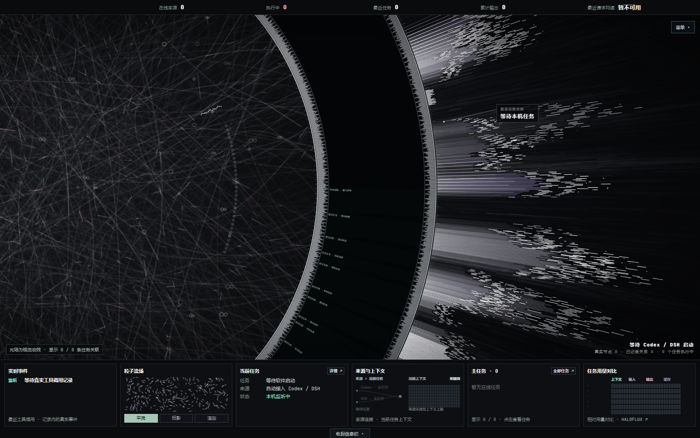

# AGT · 个人 Agent 作战大屏

把这个仓库链接发给你的 AI Agent，让它帮你安装、启动属于你自己的 Agent 任务大屏。

```text
请帮我安装并运行 https://github.com/xifengyilieng/agt-command-center 。
先阅读 README.md 和 AGENT_INSTALL.md，检查我的系统环境，然后完成安装和健康检查。
默认先用浏览器打开；如果我提出桌面壁纸需求，再安装 Wallpaper Engine 集成。
```

**Windows 10/11 · Python 3.10+ · 运行无第三方 Python 依赖 · 可选 Wallpaper Engine**



预览使用空数据状态；安装后展示你自己电脑上已记录的任务。

基于 **HALOFLUX by Ryder191（RYDER CODE / Ms MAIKEBAIs CAT）** 修改。继承原作非商业限制，适用范围见 [LICENSE](LICENSE)。

## 能做什么

- 自动发现本机 Codex、DeepSeek Harness（DSH）的会话记录，展示主任务、协作子任务、状态、模型、用量、上下文和已记录的工具关系。
- 保留 HALOFLUX 巨环、编织光场、彗星束和自动运镜；实际任务关系绑定真实记录。环境光效不代表吞吐量或任务数量。
- 中文界面，底部六块信息栏可收起，提供三档画质、暂停、任务筛选和参数控制。
- 浏览器直接使用；安装 Wallpaper Engine 后可设为可交互桌面。
- 只读监测，不向 Codex 或 DSH 发送命令，不暂停或终止它们的任务。

当前适配 Codex 和 DSH，不自动接入所有 Agent 产品。负责安装的 Agent 可以是任何具备阅读仓库、下载文件和运行本机命令能力的工具。只支持聊天的 Agent 需要用户手动执行命令。

## 交给 Agent 安装

安装 Agent 请阅读 **[AGENT_INSTALL.md](AGENT_INSTALL.md)**。克隆后也应遵循 [AGENTS.md](AGENTS.md)。默认安装只启动本机浏览器服务；桌面壁纸与开机启动是可选项。

## 手动安装

安装 Python 3.10 或更新版本，将仓库下载到一个准备长期保留的目录：

```powershell
git clone https://github.com/xifengyilieng/agt-command-center.git
cd agt-command-center
powershell.exe -NoProfile -ExecutionPolicy Bypass -File .\setup.ps1
```

没有 Git 时点击 **Code → Download ZIP**，解压后在该目录执行最后一条命令。只用 Python 标准库，无须 `pip install`、Node.js、API Key 或管理员权限。

安装器检查环境、生成页面、启动后台服务并验证健康状态，随后打开 <http://127.0.0.1:8767>。之后可双击 `启动大屏.cmd`；仅后台采集使用 `启动采集器.cmd`。

## 可选：桌面壁纸

需要自行安装 Wallpaper Engine；本项目不附带该软件。

```powershell
powershell.exe -NoProfile -ExecutionPolicy Bypass -File .\setup.ps1 -Wallpaper
```

安装器从本机 Steam 注册表和库目录定位软件。自定义路径可指定：

```powershell
powershell.exe -NoProfile -ExecutionPolicy Bypass -File .\setup.ps1 -WeDir "D:\SteamLibrary\steamapps\common\wallpaper_engine"
```

安装完成后，在 Wallpaper Engine 的「已安装」中选择 **AGT 真实任务作战桌面**，自行选择屏幕。安装器仅添加/更新项目，不更换当前壁纸或修改其他屏幕。保留仓库目录，壁纸数据由这里的采集器提供。更新后重新执行带 `-Wallpaper` 的命令同步资源。

需要登录 Windows 后自动启动采集器时，明确添加 `-Startup -NoBrowser`。取消开机启动可删除当前用户启动目录中的 `AGT Task Collector.lnk`。

## 数据与隐私

服务仅监听 **127.0.0.1:8767**，不提供公网接口，不上传会话数据，不读取 API Key 或账号凭据。

| 来源 | 默认本机位置 | 说明 |
| --- | --- | --- |
| Codex | `~/.codex/state_*.sqlite` 与索引指向的 JSONL | 只读会话索引及日志尾部，最多加载最近 32 个未归档会话 |
| DSH | `~/.dsh/storages/session_projcache/sessions/*.json` | 最多 32 个会话投影；刷新速度受软件落盘影响 |
| CC Switch（可选） | `~/.cc-switch/cc-switch.db` | 仅匹配会话的请求统计，不读代理配置或凭据 |
| 可用技能 | `~/.codex/skills/*/SKILL.md` | 构建时提取技能名和目录名，标为可用技能，不声称任务已使用 |

自定义来源可设置 `CODEX_HOME`、`DSH_HOME` 后再运行安装器，详见 [安装指南](AGENT_INSTALL.md)。

页面可展示任务标题、工作目录、模型、状态、工具名称和用量，分享自己的截图前请检查内容。后端不向页面发送完整提示词、工具参数或工具输出。安装令牌 `.wallpaper-token` 与壁纸目录的 `connection.js` 均为本机私有文件，不应上传。

任务状态基于记录事件和进程探测，可能滞后；历史会话不表示仍在线。缺少首字时间时，请求均速为含等待的估计，以 `≈` 显示；缺少数据时显示等待或未知。没有来源时保持空状态，不生成假任务。

## 常见问题

- **找不到 Python**：安装 Python 3.10+ 后重开终端。启动器依次检查 `python`、`py -3` 和 `python3`。
- **没有任务**：先启动 Codex 或 DSH 并产生记录；执行 `python check_environment.py` 检查索引。非标准目录需配置环境变量。仅有旧记录、软件未运行时，不显示为在线任务。
- **8767 端口占用**：检查占用者，不要结束未知进程。启动器与壁纸连接默认使用此端口。
- **壁纸数据离线**：运行 `启动采集器.cmd`，确认 `/api/health` 正常；令牌改变后重启采集器，重新执行壁纸安装并在宿主重载此壁纸。
- **找不到 Wallpaper Engine**：使用 `-WeDir` 指向含 `wallpaper64.exe` 或 `wallpaper32.exe` 的目录。
- **掉帧**：选择「流畅」，检查宿主帧率和暂停规则。DeskGo 兼容与异常恢复范围见 [安装指南](AGENT_INSTALL.md)。

## 开发与验证

```powershell
python build_screen.py
python -m unittest discover -s tests -v
node --check runtime.js
```

`index.html`、`runtime.js` 每台电脑本机构建，不加入版本库。修改界面后重新构建；后端变更后重启本项目服务。可选前端测试使用 `npm run test:public`，详见 [开发验证](AGENT_INSTALL.md#开发验证)。普通使用不需要 Node.js 或 npm。

## 原作与许可

Modified from **HALOFLUX by Ryder191（RYDER CODE / Ms MAIKEBAIs CAT）**。

原作：[Ryder191/haloflux](https://github.com/Ryder191/haloflux)。来源、基线与修改说明见 [UPSTREAM.txt](UPSTREAM.txt)，上游源码保留在 `vendor/haloflux/`。

Required Notice: Copyright (c) 2026 Ryder191 (RYDER CODE / Ms MAIKEBAIs CAT) - https://github.com/Ryder191/haloflux

Required Notice: Noncommercial use only. Any commercial use is strictly prohibited. No commercial licenses are offered.

完整原作声明与 PolyForm Noncommercial 1.0.0 条款保留在 [LICENSE](LICENSE) 和 [vendor/haloflux/LICENSE](vendor/haloflux/LICENSE)。字体单独适用 [SIL Open Font License](vendor/fonts/OFL.txt)。本项目界面不加载或播放原作配乐。
